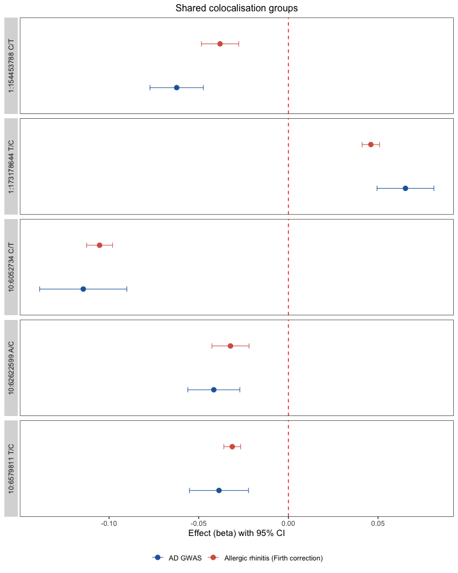

The GPMap API allows you to upload your own GWAS summary statistics and receive colocalisation results against the existing GPMap. This vignette covers how to upload a GWAS, retrieve your results, interpret them, and compare your upload with another trait (including another upload) to find insights.

## Uploading a GWAS

Use `gpmapr::upload_gwas()` to submit your summary statistics. You need a file with standard GWAS columns and metadata such as sample size and ancestry.


``` r
# Example: upload a GWAS file
result <- gpmapr::upload_gwas(
  file = "path/to/your_gwas.tsv.gz",
  name = "Specific Triat",
  p_value_threshold = 5e-8,
  chr_col = "chr",
  bp_col = "pos",
  p_col = "pval",
  ea_col = "effect_allele",
  oa_col = "other_allele",
  eaf_col = "eaf",
  beta_col = "beta",
  se_col = "se",
  email = "your@email.com",
  variable_type = "continuous",
  ancestry = "EUR",
  sample_size = 50000,
  reference_build = "GRCh38"
)
```

The `*_col` arguments name the columns in your file. `chr_col`, `bp_col`, `ea_col`, `oa_col` and `p_col` are required, along with either `beta_col` and `se_col`, or `or_col`, `or_lb_col` and `or_ub_col` for odds ratios. `eaf_col`, `snp_col` and `rsid_col` are optional.

You can also compare your upload with another upload by passing the GUIDs of the uploads you want to compare with, by including `compare_with_upload_guids = c("GUID1")`.

The response includes a **GUID** (a UUID such as `a1b2c3d4-e5f6-7890-abcd-ef1234567890`). Save this GUID; you use it to fetch your results once they are ready.


``` r
# The GUID is returned in the response
my_guid <- result$guid
```

## Fetching your results

Processing can take some time. Use the GUID with `trait()` (or `get_gwas()`) to check status and retrieve results.  Here we will use a GWAS that has already been uploaded to the GPMap.

This is of Atopic Dermatitis.


``` r
my_guid <- "7a289615-c1b4-91f3-3d97-887f60de9155"
my_results <- gpmapr::trait(my_guid, include_associations = TRUE)
```

When processing is complete, the result has the same tables as any trait: `trait` (your upload's details), `study_extractions`, `coloc_groups` and `coloc_pairs`. With `include_associations = TRUE`, each study's association at its variant (`beta`, `se`, `p`, `eaf`, `imputed`) is added to the coloc groups and study extractions.

## Interpreting your results

Much of the same analysis that is shown in the [case study](https://mrcieu.r-universe.dev/articles/gpmapr/tutorial-case-study.html) can be applied to your upload results.

### Your upload's rows and everyone else's

Your results mix rows for your upload with rows for the studies already in the GPMap that it colocalises with. The `source` column says which:

* `source == "upload"`: a study extraction from an uploaded GWAS. `gwas_upload_id` is the id of that upload: yours (`my_results$trait$id`), or another upload you compared with.
* `source == "existing"`: a study extraction already in the GPMap, with its `trait_id` and `study_id`. `gwas_upload_id` is `NA`.

Uploaded and existing study extractions are numbered separately, so the same id can mean one of each: always identify a study extraction by `source` and its id together. Your upload's own rows are the ones with `source == "upload"` and `gwas_upload_id == my_results$trait$id`.


``` r
own_extractions <- my_results$study_extractions |>
  dplyr::filter(source == "upload", gwas_upload_id == my_results$trait$id)
paste("Study extractions from your upload:", nrow(own_extractions))
#> [1] "Study extractions from your upload: 144"
paste("Existing study extractions it colocalises with:", sum(my_results$study_extractions$source == "existing"))
#> [1] "Existing study extractions it colocalises with: 3854"
```

### Comparing your upload with another trait

**Coloc groups** identify genomic regions (LD blocks) where your trait colocalises with other studies in the map; each row is a study extraction in the group. **Coloc pairs** give the pairwise colocalisation probabilities between two study extractions:

- **h4**: both traits share **one common causal variant**
- **h3**: both traits associate at the region through **two distinct causal variants**

Coloc groups give the more robust view of the relationship between your trait and another, but coloc pairs can show loci that are less powered and so not captured by a coloc group.

`compare_upload()` lines your upload up with another trait (here allergic rhinitis, trait 2527). For every coloc group containing both, it gives each one's effect at the group's variant, taken from your upload's results so that both are on the same alleles; it also lists the coloc pairs between them.


``` r
trait_to_compare <- 2527L # Allergic rhinitis
comparison <- gpmapr::compare_upload(my_results, trait_to_compare)
upload_name <- as.character(my_results$trait$name)[[1L]]
compare_name <- if (nrow(comparison$coloc_groups) > 0) comparison$coloc_groups$trait_name[[1L]] else "Comparison trait"

knitr::kable(
  head(comparison$coloc_groups[, c("display_snp", "upload_beta", "upload_se", "trait_beta", "trait_se")], 10),
  digits = 3
)
```


|display_snp      | upload_beta| upload_se| trait_beta| trait_se|
|:----------------|-----------:|---------:|----------:|--------:|
|1:154453788 C/T  |      -0.062|     0.008|     -0.038|    0.005|
|1:173178644 T/C  |       0.065|     0.008|      0.046|    0.002|
|10:6052734 C/T   |      -0.114|     0.012|     -0.105|    0.004|
|10:62622599 A/C  |      -0.042|     0.007|     -0.032|    0.005|
|10:6579811 T/C   |      -0.039|     0.008|     -0.031|    0.002|
|11:128317488 T/C |      -0.055|     0.007|     -0.028|    0.005|
|11:65784486 A/G  |      -0.088|     0.007|     -0.051|    0.005|
|11:76582761 G/C  |       0.079|     0.007|      0.091|    0.002|
|12:56930729 T/G  |      -0.044|     0.013|     -0.071|    0.004|
|17:40608272 T/A  |       0.222|     0.037|      0.274|    0.008|


``` r

forest_rows <- comparison$coloc_groups |>
  utils::head(5) |>
  dplyr::mutate(panel = factor(display_snp, levels = unique(display_snp)))
forest_df <- dplyr::bind_rows(
  forest_rows |> dplyr::transmute(panel, beta = upload_beta, se = upload_se, trait_lbl = upload_name),
  forest_rows |> dplyr::transmute(panel, beta = trait_beta, se = trait_se, trait_lbl = compare_name)
) |>
  dplyr::mutate(trait_lbl = factor(trait_lbl, levels = c(upload_name, compare_name)))

trait_colours <- stats::setNames(c("#2166ac", "#d6604d"), c(upload_name, compare_name))

if (nrow(forest_df) > 0) {
  ggplot2::ggplot(forest_df, ggplot2::aes(x = beta, y = trait_lbl, colour = trait_lbl)) +
    ggplot2::geom_vline(xintercept = 0, colour = "red", lty = 2) +
    ggplot2::geom_errorbar(
      ggplot2::aes(xmin = beta - 1.96 * se, xmax = beta + 1.96 * se),
      width = 0.12, linewidth = 0.35
    ) +
    ggplot2::geom_point(size = 2.5) +
    ggplot2::facet_grid(rows = ggplot2::vars(panel), switch = "y") +
    ggplot2::scale_colour_manual(values = trait_colours) +
    ggplot2::theme_bw() +
    ggplot2::theme(
      panel.grid = ggplot2::element_blank(),
      strip.background = ggplot2::element_rect(colour = NA),
      strip.placement = "outside",
      plot.title = ggplot2::element_text(hjust = 0.5, size = 12),
      legend.position = "bottom",
      axis.text.y = ggplot2::element_blank(),
      axis.ticks.y = ggplot2::element_blank()
    ) +
    ggplot2::labs(x = "Effect (beta) with 95% CI", y = NULL, colour = NULL, title = "Shared colocalisation groups")
}
```

<div class="figure">

<p class="caption">plot of chunk coloc-groups-demo</p>
</div>

The coloc pairs between your upload and the trait include loci with no shared coloc group (`in_shared_coloc_group` is `FALSE`):


``` r
knitr::kable(
  head(dplyr::filter(comparison$coloc_pairs, h4 > 0.8, !in_shared_coloc_group), 20),
  digits = 3
)
```


| ld_block_id| upload_study_extraction_id|upload_display_snp |trait_name                           | trait_study_extraction_id|trait_display_snp |    h3|    h4|in_shared_coloc_group |
|-----------:|--------------------------:|:------------------|:------------------------------------|-------------------------:|:-----------------|-----:|-----:|:---------------------|
|        1000|                       7243|12:122161325 A/G   |Allergic rhinitis (Firth correction) |                   3271358|12:122177244 C/T  | 0.038| 0.960|FALSE                 |
|        1064|                       7257|14:35399308 C/T    |Allergic rhinitis (Firth correction) |                   3458752|14:35395672 G/T   | 0.007| 0.989|FALSE                 |
|        1246|                       7283|18:62342581 C/T    |Allergic rhinitis (Firth correction) |                   4323482|18:62343215 A/C   | 0.014| 0.977|FALSE                 |
|         121|                       7331|2:28413873 A/G     |Allergic rhinitis (Firth correction) |                    502135|2:28407025 T/C    | 0.055| 0.927|FALSE                 |
|        1349|                       7323|22:36914912 A/G    |Allergic rhinitis (Firth correction) |                   4897281|22:36918137 A/T   | 0.075| 0.924|FALSE                 |
|         479|                       7360|5:142112420 C/T    |Allergic rhinitis (Firth correction) |                   1501532|5:142159774 C/A   | 0.127| 0.836|FALSE                 |


All of your upload's coloc pairs are in `my_results$coloc_pairs`. Each side (`a`, `b`) is identified by `study_extraction_a_id` and `source_a`, with its trait name, data type, tissue and gene alongside (`trait_name_a`, ...).

## Deleting an upload

If you no longer want an upload stored in the GPMap, you can permanently delete it, along with all of its results, using `delete_gwas()`. You need to provide the same email address that you used for the upload. Uploads that are still processing can't be deleted.


``` r
gpmapr::delete_gwas(my_guid, email = "your@email.com")
```
